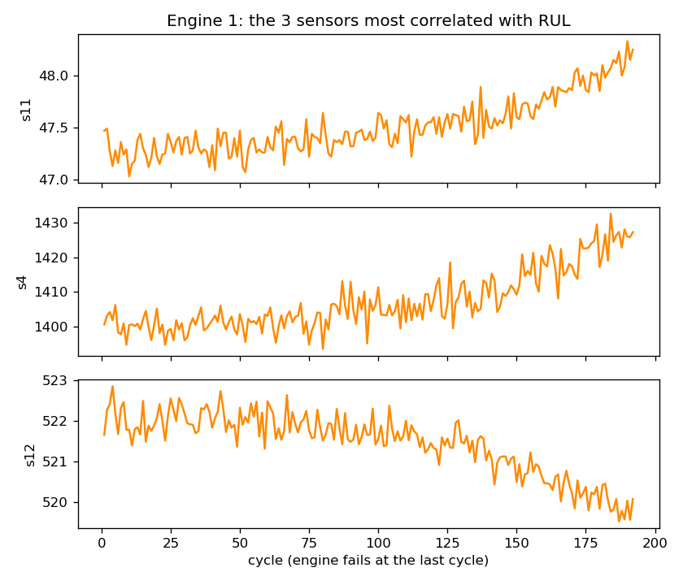

# Turbofan Engine Maintenance

I am learning how to predict when a jet engine will fail, using NASA's
C-MAPSS simulated engine data. Each engine runs until it fails, and sensors
record every cycle. The goal is to predict Remaining Useful Life (RUL): how
many cycles are left.

This is a learning project. See [LEARNING.md](LEARNING.md) for the steps.

## Setup

```powershell
python -m venv .venv
.venv\Scripts\python -m pip install pandas scikit-learn matplotlib pytest
.venv\Scripts\python scripts/download_data.py
.venv\Scripts\python scripts/step1_load.py
.venv\Scripts\python -m pytest
.venv\Scripts\python scripts/step3_sensors.py
.venv\Scripts\python scripts/step4_baseline.py
.venv\Scripts\python scripts/step5_sqlite.py
```

## Results (FD001)

Six of the 21 sensors never change, so they are dropped. The rest drift as the
engine wears out. These three track RUL most closely:



Models train on 100 engines and are scored on 100 different engines, using
each test engine's last recorded cycle. RUL is capped at 125 cycles.

| Model | RMSE (cycles) |
| --- | --- |
| Predict the training mean | 41.9 |
| Linear regression | 20.8 |
| Random forest (100 trees) | 17.3 |

Single run, one sub-dataset (FD001), no tuning. [Saved results](docs/baseline-results.json).

`step5_sqlite.py` loads the cycles into SQLite and queries lifetimes:
the 100 training engines last 128 to 362 cycles (average 206).

Data source: [NASA C-MAPSS](https://data.nasa.gov/dataset/cmapss-jet-engine-simulated-data).
The data is not stored in this repo. `download_data.py` fetches it.
